<!-- Conversão do notebook logger_general_exemplos.ipynb; Markdown, código e saídas textuais preservados. -->
> **Nota de renderização:** as imagens SVG foram reconstruídas diretamente das saídas HTML/CSS e ANSI armazenadas no notebook, com a mesma paleta semântica. Não são capturas de tela. No GitHub, os exemplos coloridos são SVGs vetoriais na pasta `logger_general_exemplos_assets/`, junto ao Markdown. Cada imagem tem uma versão textual copiável.
> **Fonte:** `logger_general_exemplos.ipynb` (22 células, preservadas na ordem original). Imagens de saída estáticas: não executam Python nem HTML.

# Logger General — JSON, ANSI e HTML no Jupyter

**Laboratório independente, portátil e offline**. Mostra três separações: dados JSON, logging humano e apresentação colorida. Não depende de Anthropic, agentes ou do repositório `curso_claude`.

Abra a partir da pasta extraída com `make notebook` (instale o Jupyter opcionalmente com `make setup-notebook`). O pacote central `logger_general.py` só usa biblioteca padrão do Python.

As duas células com prévia **HTML colorida** foram salvas usando apenas **dados de demonstração**, permitindo visualizar cores imediatamente ao abrir o notebook. Reexecute as células para regenerar as saídas. O tema HTML é separado da paleta ANSI do terminal.

## 1 — Importações e contrato

`GeneralLogger`: mensagem humana e `.log` sem cores persistidas. `JsonlWriter`: eventos estruturados independentes de logger. `render_json`: string ANSI/sem cores. `render_json_html`: HTML com valores escapados, renderizado pelo Jupyter.

<!-- Celula de código 2, execução [1] -->
```python
from pathlib import Path
from tempfile import TemporaryDirectory
import io
import json
import sys

from IPython.display import HTML, display

# O Jupyter pode iniciar o kernel em notebooks/ (e não na raiz).
PROJETO = next(
    (p for p in (Path.cwd(), *Path.cwd().parents) if (p / "logger_general.py").is_file()),
    None,
)
assert PROJETO is not None, "Notebook deve estar dentro da pasta logger_general_portable"
sys.path.insert(0, str(PROJETO))

from logger_general import (
    GeneralLogger, JsonlWriter, render_json, render_json_html,
    print_json, view_file,
)

print("Tudo importado sem APIs externas.")
```

**Saída textual registrada**

```text
Tudo importado sem APIs externas.
```

## 2 — Dados do experimento

Variáveis com listas, números decimais, booleanos, `None` → JSON `null`, campos de status e Unicode. São dados fictícios de teste.

<!-- Celula de código 4, execução [2] -->
```python
exemplo = {
    "trace_id": "demo-001",
    "status": "denied",
    "message": "Acesso negado a recurso fictício",
    "attempts": 2,
    "duration_ms": 1.508,
    "retry": False,
    "value": None,
    "payload": {"items": [1, 2.75, True], "country": "Brasil", "ação": "negada"},
}

print_json(exemplo, color="never")
```

**Saída textual registrada**

```text
{
  "trace_id": "demo-001",
  "status": "denied",
  "message": "Acesso negado a recurso fictício",
  "attempts": 2,
  "duration_ms": 1.508,
  "retry": false,
  "value": null,
  "payload": {
    "items": [
      1,
      2.75,
      true
    ],
    "country": "Brasil",
    "ação": "negada"
  }
}
```

## 3 — Pretty JSON com realce HTML **nativo do Jupyter**

A opção mais confiável para notebooks: `display(HTML(...))` interpreta as tags `<pre>` / `<span>` e aplica CSS nas cores; os valores do JSON são escapados por `html.escape`. A prévia abaixo já está salva.

<!-- Celula de código 6, execução [3] -->
```python
display(HTML(render_json_html(exemplo, indent=2)))
```

**Saída [3] — HTML colorido**

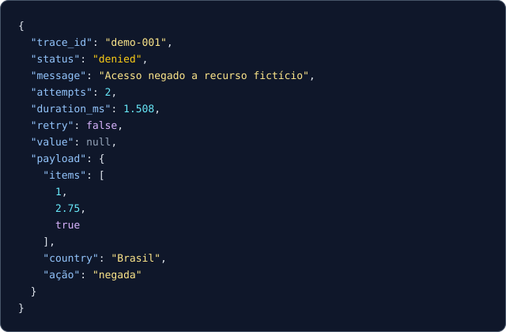

<details><summary>Mostrar conteúdo textual (acessível e copiável)</summary>

```json
{
  "trace_id": "demo-001",
  "status": "denied",
  "message": "Acesso negado a recurso fictício",
  "attempts": 2,
  "duration_ms": 1.508,
  "retry": false,
  "value": null,
  "payload": {
    "items": [
      1,
      2.75,
      true
    ],
    "country": "Brasil",
    "ação": "negada"
  }
}
```

</details>

## 4 — A mesma informação colorida com ANSI

ANSI usa `ESC[94m` (chaves), `ESC[93m` (strings), `ESC[96m` (números), `ESC[95m` (booleanos), `ESC[90m` (`null`). É um protocolo do **terminal**, e alguns frontends Jupyter podem mostrar menos cores. Use `render_json_html` para uma saída visual estável.

<!-- Celula de código 8, execução [4] -->
```python
ansi_texto = render_json(exemplo, pretty=True, color="always")
print(ansi_texto)

# Prova de roundtrip: remover apenas sequências ANSI, ainda é JSON válido.
import re
sem_escape = re.sub(r"\x1b\[[0-9;]*m", "", ansi_texto)
assert json.loads(sem_escape) == exemplo
print("PASS: valores preservados e JSON válido")
```

**Saída ANSI colorida**

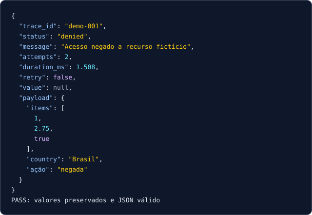

<details><summary>Mostrar saída textual sem ANSI</summary>

```text
{
  "trace_id": "demo-001",
  "status": "denied",
  "message": "Acesso negado a recurso fictício",
  "attempts": 2,
  "duration_ms": 1.508,
  "retry": false,
  "value": null,
  "payload": {
    "items": [
      1,
      2.75,
      true
    ],
    "country": "Brasil",
    "ação": "negada"
  }
}
PASS: valores preservados e JSON válido
```

</details>

## 5 — Campos semânticos personalizáveis

O módulo não conhece a aplicação. Basta registrar um campo como `deployment` e os seus valores; nenhum código do highlighter precisa ser editado.

<!-- Celula de código 10, execução [5] -->
```python
regras = {
    "deployment": {"deployed": "success", "rollback": "error"},
    "pipeline": {"waiting": "warning"},
}

implantacao = {
    "deployment": "rollback",
    "pipeline": "waiting",
    "elapsed_ms": 0.84,
    "components": [{"deployment": "deployed", "count": 2}],
}

display(HTML(render_json_html(implantacao, semantic_rules=regras)))
```

**Saída [5] — HTML colorido**

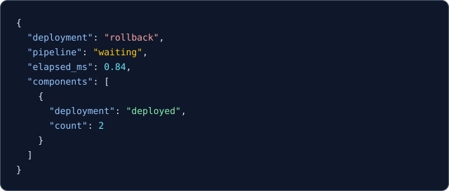

<details><summary>Mostrar conteúdo textual (acessível e copiável)</summary>

```json
{
  "deployment": "rollback",
  "pipeline": "waiting",
  "elapsed_ms": 0.84,
  "components": [
    {
      "deployment": "deployed",
      "count": 2
    }
  ]
}
```

</details>

## 6 — Eventos sucessivos: verde, amarelo e vermelho

`status` e `level` podem destacar significado semântico **além da sintaxe**. Não confundir cor da apresentação com uma decisão de autorização real.

<!-- Celula de código 12, execução [6] -->
```python
eventos = [
    {"event_id": "1", "status": "success", "level": "INFO", "ok": True},
    {"event_id": "2", "status": "denied", "level": "WARNING", "ok": False},
    {"event_id": "3", "status": "failed", "level": "ERROR", "ok": False},
]

for evento in eventos:
    display(HTML(render_json_html(evento)))
```

**Saída [6] — HTML colorido (1/3)**

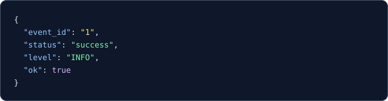

<details><summary>Mostrar conteúdo textual (acessível e copiável)</summary>

```json
{
  "event_id": "1",
  "status": "success",
  "level": "INFO",
  "ok": true
}
```

</details>

**Saída [6] — HTML colorido (2/3)**

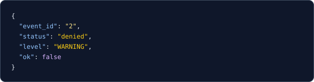

<details><summary>Mostrar conteúdo textual (acessível e copiável)</summary>

```json
{
  "event_id": "2",
  "status": "denied",
  "level": "WARNING",
  "ok": false
}
```

</details>

**Saída [6] — HTML colorido (3/3)**

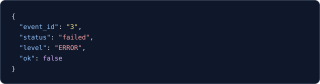

<details><summary>Mostrar conteúdo textual (acessível e copiável)</summary>

```json
{
  "event_id": "3",
  "status": "failed",
  "level": "ERROR",
  "ok": false
}
```

</details>

## 7 — JSONL gravado sem ANSI e visualizado em streaming

O `JsonlWriter` escreve dados puros; `view_file` percorre os registros incrementalmente e só colore a visualização. Esta célula usa um **diretório temporário** e não grava arquivos no seu projeto.

<!-- Celula de código 14, execução [7] -->
```python
with TemporaryDirectory() as pasta:
    path = Path(pasta) / "eventos.jsonl"
    with JsonlWriter(path) as writer:
        for evento in eventos:
            writer.write(evento)
    origem = path.read_text(encoding="utf-8")
    assert "\x1b[" not in origem
    print("Arquivo original (um JSON por linha):")
    print(origem)
    print("Visualização ANSI bonita (não altera arquivo):")
    view_file(path, pretty=True, color="always")
    assert path.read_text(encoding="utf-8") == origem

print("PASS: arquivo imutável durante a visualização")
```

**Saída ANSI colorida**

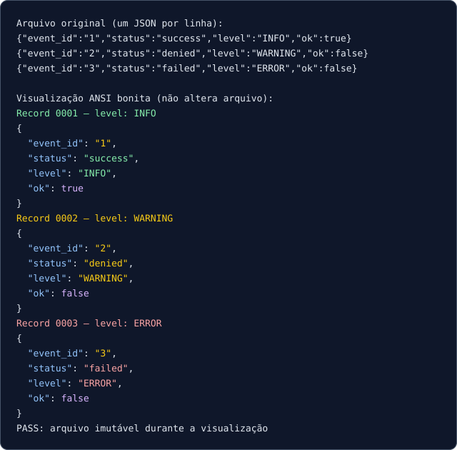

<details><summary>Mostrar saída textual sem ANSI</summary>

```text
Arquivo original (um JSON por linha):
{"event_id":"1","status":"success","level":"INFO","ok":true}
{"event_id":"2","status":"denied","level":"WARNING","ok":false}
{"event_id":"3","status":"failed","level":"ERROR","ok":false}

Visualização ANSI bonita (não altera arquivo):
Record 0001 — level: INFO
{
  "event_id": "1",
  "status": "success",
  "level": "INFO",
  "ok": true
}
Record 0002 — level: WARNING
{
  "event_id": "2",
  "status": "denied",
  "level": "WARNING",
  "ok": false
}
Record 0003 — level: ERROR
{
  "event_id": "3",
  "status": "failed",
  "level": "ERROR",
  "ok": false
}
PASS: arquivo imutável durante a visualização
```

</details>

## 8 — JSONL também pode ser exibido como HTML no Jupyter

Em vez de mandar escapes ANSI ao frontend, lemos as linhas e chamamos `display(HTML(...))`, produzindo blocos CSS nativos. Veja a demonstração com o arquivo fictício incluído no projeto.

<!-- Celula de código 16, execução [8] -->
```python
arquivo_exemplo = PROJETO / "examples" / "events.jsonl"
assert arquivo_exemplo.is_file(), "Arquivo de exemplo não encontrado no projeto"
with arquivo_exemplo.open(encoding="utf-8") as fonte:
    for linha in fonte:
        if linha.strip():
            display(HTML(render_json_html(json.loads(linha))))
```

**Saída [8] — HTML colorido (1/3)**

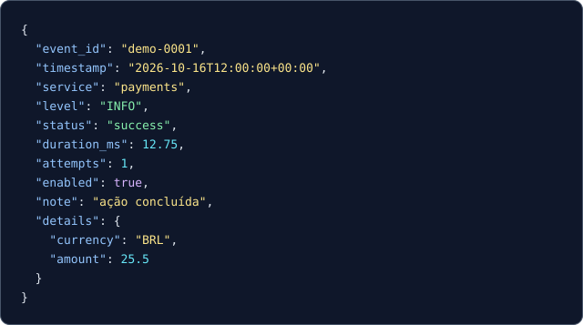

<details><summary>Mostrar conteúdo textual (acessível e copiável)</summary>

```json
{
  "event_id": "demo-0001",
  "timestamp": "2026-10-16T12:00:00+00:00",
  "service": "payments",
  "level": "INFO",
  "status": "success",
  "duration_ms": 12.75,
  "attempts": 1,
  "enabled": true,
  "note": "ação concluída",
  "details": {
    "currency": "BRL",
    "amount": 25.5
  }
}
```

</details>

**Saída [8] — HTML colorido (2/3)**

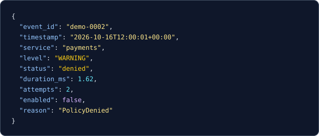

<details><summary>Mostrar conteúdo textual (acessível e copiável)</summary>

```json
{
  "event_id": "demo-0002",
  "timestamp": "2026-10-16T12:00:01+00:00",
  "service": "payments",
  "level": "WARNING",
  "status": "denied",
  "duration_ms": 1.62,
  "attempts": 2,
  "enabled": false,
  "reason": "PolicyDenied"
}
```

</details>

**Saída [8] — HTML colorido (3/3)**

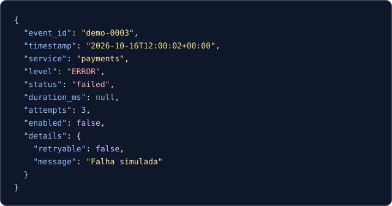

<details><summary>Mostrar conteúdo textual (acessível e copiável)</summary>

```json
{
  "event_id": "demo-0003",
  "timestamp": "2026-10-16T12:00:02+00:00",
  "service": "payments",
  "level": "ERROR",
  "status": "failed",
  "duration_ms": null,
  "attempts": 3,
  "enabled": false,
  "details": {
    "retryable": false,
    "message": "Falha simulada"
  }
}
```

</details>

## 9 — Logger humano colorido, arquivo limpo

`GeneralLogger` é independente de `JsonlWriter`. A saída do terminal contém ANSI; o arquivo `.log` é sempre texto simples. Não interfere nos handlers globais de `logging`.

<!-- Celula de código 18, execução [9] -->
```python
with TemporaryDirectory() as pasta:
    buffer = io.StringIO()
    destino = Path(pasta) / "app.log"
    with GeneralLogger(name="notebook", stream=buffer,
                       color="always", log_file=destino, level="DEBUG") as logger:
        logger.info("Aplicação iniciou")
        logger.debug("Verificando dados fictícios")
        logger.warning("Evento negado (exemplo)")
        logger.error("Falha simulada")

    print("Saída de terminal/stream ANSI:")
    print(buffer.getvalue())
    print("Arquivo sem ANSI:")
    print(destino.read_text(encoding="utf-8"))
    assert "\x1b" not in destino.read_text(encoding="utf-8")

print("PASS: arquivos não armazenam sequências de cor")
```

**Saída ANSI colorida**

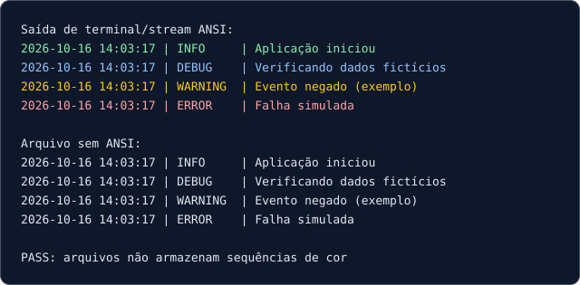

<details><summary>Mostrar saída textual sem ANSI</summary>

```text
Saída de terminal/stream ANSI:
2026-10-16 14:03:17 | INFO     | Aplicação iniciou
2026-10-16 14:03:17 | DEBUG    | Verificando dados fictícios
2026-10-16 14:03:17 | WARNING  | Evento negado (exemplo)
2026-10-16 14:03:17 | ERROR    | Falha simulada

Arquivo sem ANSI:
2026-10-16 14:03:17 | INFO     | Aplicação iniciou
2026-10-16 14:03:17 | DEBUG    | Verificando dados fictícios
2026-10-16 14:03:17 | WARNING  | Evento negado (exemplo)
2026-10-16 14:03:17 | ERROR    | Falha simulada

PASS: arquivos não armazenam sequências de cor
```

</details>

## 10 — Segurança visual do HTML

O módulo **não executa tags HTML** contidas nos dados do JSON: o texto é escapado, mantendo somente os `<span>` criados pelo formatador. A célula seguinte mostra literalmente a string perigosa como dado, e não como script.

<!-- Celula de código 20, execução [10] -->
```python
conteudo_nao_confiavel = {
    "status": "failed",
    "message": '<script>alert("não executar")</script>',
    "tags": "<b>texto de usuário</b>",
}
markup = render_json_html(conteudo_nao_confiavel)
assert "<script>" not in markup
assert "&lt;script&gt;" in markup
display(HTML(markup))
```

**Saída [10] — HTML colorido**

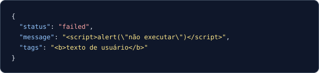

<details><summary>Mostrar conteúdo textual (acessível e copiável)</summary>

```json
{
  "status": "failed",
  "message": "<script>alert(\"não executar\")</script>",
  "tags": "<b>texto de usuário</b>"
}
```

</details>

## 11 — Propostas de extensão (exercícios)

1. Defina regras semânticas para `health: healthy|degraded|down`.
2. Gere um JSONL com 50 eventos e visualize apenas cinco eventos em HTML, mantendo o arquivo intocado.
3. Compare `color="never"` e `color="always"` em `render_json` e remova os escapes do segundo para validar o roundtrip com `json.loads`.
4. Injete uma classe `GeneralLogger` em uma função independente e teste seu output com `io.StringIO`.
5. Experimente um objeto que precise de `default=` em `json.dumps`, preservando dados válidos.

**Contrato:** colorização é apresentação. Não é política de segurança, auditoria, redaction ou monitoramento de produção. Veja README e `docs/ARQUITETURA.md`.

---

*Exportação gerada a partir das saídas efetivamente salvas no notebook. Cores e formatação visual podem variar ligeiramente em relação à interface do Jupyter, conforme o tema, navegador e fontes disponíveis.*